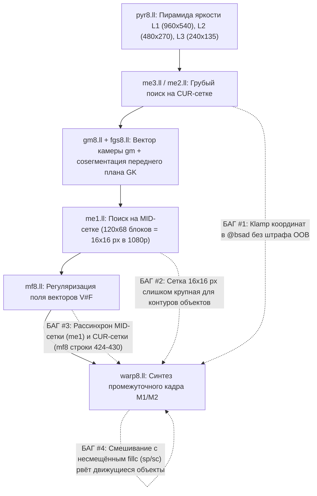

# Ночная Роадмапа Исследований VCFG (Overnight Research Roadmap)

Этот документ — мастер-план для запуска длительных автономных ночных исследований в отдельных чатах. Главный фокус — **глобальный ресерч и пересборка алгоритма Frame Generation (Optical Flow + Warp/Synthesis)** для устранения искажений («желе»/варпов) на движущихся объектах и разрывов по краям экрана.

> [!TIP]
> **Рекомендуемые слэш-команды для запуска ночных чатов:**
> - Используйте **`/goal`** в начале промпта в новом чате — это включает режим длительного автономного достижения цели (агент не остановится на полпути, пока не прогонит все симуляции, не соберёт шейдеры, не проверит лимиты `vgprs <= 64` и не подтвердит улучшение метрик).
> - Используйте **`/boost`** для задач полной переархитектуры (`chat5_fg_from_scratch.md`), где требуется глубокий математический анализ, сравнение нескольких архитектур оптического потока и строгая верификация.

---

## 1. Архитектурный диагноз: почему сейчас много искажений на движущихся объектах и по краям кадра

Мы провели полный аудит текущего конвейера `Mode 8` ([`classic/source/main.c`](file:///C:/Users/user/Documents/Codex/2026-10-18/new-chat/work/vcfg-alt/classic/source/main.c#L1097-L1135): `pyr8` $\to$ `me3` $\to$ `me2` $\to$ `gm8` $\to$ `fgs8` $\to$ `me1` $\to$ `mf8` $\to$ `phase8` $\to$ `warp8`) и выявили **4 фундаментальные причины** артефактов:

### Причина №1: Искажения по краям кадра (`Screen-Edge / Border Warping`)
1. **Слепой clamp к границе в `@bsad` ([`me1.ll`](file:///C:/Users/user/Documents/Codex/2026-10-18/new-chat/work/vcfg-alt/classic/shaders/me1.ll#L74-L91), [`me2.ll`](file:///C:/Users/user/Documents/Codex/2026-10-18/new-chat/work/vcfg-alt/classic/shaders/me2.ll#L50-L67), [`mf8.ll`](file:///C:/Users/user/Documents/Codex/2026-10-18/new-chat/work/vcfg-alt/classic/shaders/mf8.ll#L60-L77)):**
   - В `@bsad` координаты блока зажимаются в `[0, wl - 8]` по X и `[0, hl - 1]` по Y **без какого-либо штрафа за выход за границы экрана (OOB)**.
   - Когда камера поворачивается (например, `gm = (-32, 0)` px), для крайних блоков экрана одна из выборок (`P(X + d/2)` или `C(X - d/2)`) выходит за пределы кадра. Из-за `smax/smin` шейдер сравнивает сжатую полоску краевых пикселей с внутренними пикселями кадра, получает ложный SAD и записывает в краевые блоки `(0, 0)` или обрезанный вектор, тогда как соседние внутренние блоки имеют вектор камеры `gm`. На границе между ними возникает **кольцо сильного растяжения/сдвига шириной 16–64 пикселя по всему периметру экрана**.
2. **Константная ошибка `eb = 0.1` и подмена выборки в [`warp8.ll`](file:///C:/Users/user/Documents/Codex/2026-10-18/new-chat/work/vcfg-alt/classic/shaders/warp8.ll#L47-L78) (`@taps` / `@tapsq`):**
   - Когда один из концов вектора выходит за `[0, 1920] x [0, 1080]` (`%one = true`), `@taps` копирует валидный конец в оба (`%a2 = %b2`) и принудительно ставит ошибку `%eb = 0.1`, а затем в `merge:` всё равно разрешает смешивание с **несмещённым статическим пикселем `fillc = lerp(sp, sc, tsc)`** по краям экрана, что даёт двоение и рваную рамку при любом вращении камеры.

### Причина №2: Противоречие систем координат между `me1.ll` и `mf8.ll` (ломает движущиеся объекты)
- В [`me1.ll`](file:///C:/Users/user/Documents/Codex/2026-10-18/new-chat/work/vcfg-alt/classic/shaders/me1.ll#L511) поиск векторов `V#FT` идёт на **центральной (MID) сетке**: сравниваются `P(X + cx/2)` и `C(X - cx/2)`.
- Но в следующем же проходе [`mf8.ll`](file:///C:/Users/user/Documents/Codex/2026-10-18/new-chat/work/vcfg-alt/classic/shaders/mf8.ll#L424-L430) для всех блоков без флага `isfgk` (`%nfgk = true`) координаты перед вызовом `@bsad` сдвигаются на `%Xu = %X + %cx/2`, то есть `@bsad` внезапно вычисляет SAD на **CUR-сетке (`P(X + cx)` против `C(X)`)**!
- В результате: любой движущийся объект (конечности персонажа, плащ, оружие, средние по скорости объекты), который `me1` нашёл в точке `X` промежуточного кадра (`t = 0.5`), в `mf8` проверяется в точке `X` кадра `C` (где объекта уже нет или ещё нет!), получает огромный SAD и **затирается вектором фона соседей**.

### Причина №3: Слишком крупная сетка векторов `120x68` (`16x16` пикселей в 1080p)
- Поле `V#F` имеет разрешение всего `120 x 68` (`16x16` пикселей экрана на один вектор). Силуэт движущегося персонажа, меча или головы всегда разрезает блоки `16x16`, создавая ступенчатые («блочные/желейные») искажения вокруг контура объекта.
- При этом буфер `g_work` выделяет **2 МБ** (`WORK_SZ_8 = 0x200000`), из которых сейчас используется меньше **350 КБ**! Мы можем без увеличения памяти перейти на сетку **`240 x 135` (`8x8` пикселей)** или хранить **двунаправленные поля ($V_{C \to P}$, $V_{P \to C}$) + карту окклюзий**.

### Причина №4: Наслоение эвристик в `warp8.ll` (`@mlp_cw` + возврат к статике `fillc`)
- В [`warp8.ll`](file:///C:/Users/user/Documents/Codex/2026-10-18/new-chat/work/vcfg-alt/classic/shaders/warp8.ll#L925-L982) при любом несовпадении выборок `P(x + t*v)` и `C(x - (1-t)*v)` (`emov > 0.15..0.25`, что неизбежно на вращающихся/размытых движущихся объектах и в зонах дизокклюзии) вес `cw` (`cw2`, `bgw`, `dsw`, `@mlp_cw`) смешивает сдвинутый пиксель `mov` со **статическим несмещённым пикселем `fillc = lerp(sp, sc, tsc)` в точке `x`**.
- Смешивание объекта в точке `x + 0.5*v` с фоном/призраком в точке `x` визуально выглядит как **разрыв («варп/желе») прямо поверх движущегося объекта**. На движущемся объекте при `emov > 0.2` нужно выбирать **лучшую из двух направленных выборок (`a2` из `P` или `b2` из `C`)**, а не тянуть пиксель назад к статическим координатам `sp`/`sc`!

---

## 2. Что и где лежит в проекте (Карта репозитория)

| Компонент | Путь | Описание |
| :--- | :--- | :--- |
| **Плагин (C/Gnm/PM4)** | [`classic/source/main.c`](file:///C:/Users/user/Documents/Codex/2026-10-18/new-chat/work/vcfg-alt/classic/source/main.c) | Инициализация памяти, таблица дескрипторов `tb[]`, `build_dcb_flow8` (строки 1046–1239), пейсер кадров. |
| **Сканнер векторов движка** | [`classic/source/gv.h`](file:///C:/Users/user/Documents/Codex/2026-10-18/new-chat/work/vcfg-alt/classic/source/gv.h) | Поиск `T#` буферов скорости/глубины в PM4 DCB командных буферах игры. |
| **Генератор шейдеров** | [`classic/gen_shaders.py`](file:///C:/Users/user/Documents/Codex/2026-10-18/new-chat/work/vcfg-alt/classic/gen_shaders.py) | Компиляция `classic/shaders/*.ll` через `llc.exe -mcpu=gfx700 -O2` в `classic/source/shaders.h`. |
| **Пирамида яркости** | [`classic/shaders/pyr8.ll`](file:///C:/Users/user/Documents/Codex/2026-10-18/new-chat/work/vcfg-alt/classic/shaders/pyr8.ll) | Генерация уровней `L1` (960x540), `L2` (480x270), `L3` (240x135) из `T#cur`. |
| **Поиск движения (L3/L2)** | [`classic/shaders/me3.ll`](file:///C:/Users/user/Documents/Codex/2026-10-18/new-chat/work/vcfg-alt/classic/shaders/me3.ll), [`me2.ll`](file:///C:/Users/user/Documents/Codex/2026-10-18/new-chat/work/vcfg-alt/classic/shaders/me2.ll) | Иерархический блочный поиск на `L3` (30x17) и `L2` (60x34) на CUR-сетке. |
| **Камера и сегментация FG** | [`classic/shaders/gm8.ll`](file:///C:/Users/user/Documents/Codex/2026-10-18/new-chat/work/vcfg-alt/classic/shaders/gm8.ll), [`fgs8.ll`](file:///C:/Users/user/Documents/Codex/2026-10-18/new-chat/work/vcfg-alt/classic/shaders/fgs8.ll) | Оценка глобального вектора камеры `gm` и forward-splat ключей переднего плана в `V#GK`. |
| **Точный поток и фильтр (L1)** | [`classic/shaders/me1.ll`](file:///C:/Users/user/Documents/Codex/2026-10-18/new-chat/work/vcfg-alt/classic/shaders/me1.ll), [`mf8.ll`](file:///C:/Users/user/Documents/Codex/2026-10-18/new-chat/work/vcfg-alt/classic/shaders/mf8.ll) | Блочный поиск `120x68` на `L1` (`V#FT`) и MRF/ICM-фильтрация (`V#F`). |
| **Синтез кадра (Warp)** | [`classic/shaders/warp8.ll`](file:///C:/Users/user/Documents/Codex/2026-10-18/new-chat/work/vcfg-alt/classic/shaders/warp8.ll), [`warp8g.ll`](file:///C:/Users/user/Documents/Codex/2026-10-18/new-chat/work/vcfg-alt/classic/shaders/warp8g.ll) | Финальный синтез промежуточного кадра `M1`/`M2` с Catmull-Rom и защитой HUD. |
| **CPU-эмулятор (1:1 NumPy)** | [`tools/bench/vcfg_motion.py`](file:///C:/Users/user/Documents/Codex/2026-10-18/new-chat/work/vcfg-alt/tools/bench/vcfg_motion.py), [`vcfg_warp.py`](file:///C:/Users/user/Documents/Codex/2026-10-18/new-chat/work/vcfg-alt/tools/bench/vcfg_warp.py) | Точная побитовая копия всех шейдеров Mode 8 на Python/NumPy для быстрых оффлайн-экспериментов! |
| **Метрики и дампы** | [`tools/bench/metrics.py`](file:///C:/Users/user/Documents/Codex/2026-10-18/new-chat/work/vcfg-alt/tools/bench/metrics.py), [`vcfg_ref.py`](file:///C:/Users/user/Documents/Codex/2026-10-18/new-chat/work/vcfg-alt/tools/bench/vcfg_ref.py) | Расчёт PSNR, SSIM, Edge-PSNR, TCE (Temporal Consistency Error) на триплетах кадров. |

---

## 3. Аппаратные ограничения PS4 GPU (`gfx700` Sea Islands / Bonaire)

Любой исследовательский чат **обязан** соблюдать жёсткие лимиты при компиляции через `classic/build.sh`:
1. **`vgprs <= 64`** на каждый шейдер (чтобы сохранять высокую заполняемость SIMD — 4 волны на EU).
2. **`ScratchSize == 0`** (никаких регистровых спиллов в память; `gen_shaders.py` отклонит любой спилл).
3. **`shader region <= 0x1C000`** (`0x8000 + aligned_sum <= 0x1C000`, то есть суммарный размер всех шейдеров Mode 8 не более `80 КБ`; сейчас занято `0x17100`, свободно `~20 КБ`).
4. **Бюджет времени GPU:** суммарное время всех проходов на 1080p не должно превышать **`~1.8–2.0 мс`** (сейчас `~1.55 мс`).
5. **Правило анонимности:** НИКОГДА не писать названия игр в коде, комментариях, тестах или коммитах — использовать **только `CUSAxxxxx`**.

---

## 4. План ночных исследовательских чатов (`.md` инструкции)

Каждый чат работает в **собственном изолированном `git worktree`** (не мешая другим чатам и основной ветке) и не трогает PS4 по FTP. Вы можете запустить их параллельно или по очереди:

### Новые глобальные ресерчи по качеству FG (Приоритет №1):
1. **[`chat5_fg_from_scratch.md`](file:///C:/Users/user/.gemini/antigravity/brain/db697d31-5142-43b7-9818-b27fbe4a757d/chat5_fg_from_scratch.md) — Полная переархитектура FG с нуля (`vcfg-r5-fg-clean`, ветка `research/fg-from-scratch`)**
   - **Задача:** Пересобрать конвейер оценивания движения и синтеза кадра с чистого листа без накопленных костылей:
     - Переход от грубой сетки `120x68` (`16x16` px) к детальной сетке **`240x135` (`8x8` px)** или иерархическому `8x8` уточнению в `me1`/`warp8` (память `WORK_SZ_8 = 2 MB` уже выделена!).
     - Явная **двунаправленная согласованность (Forward-Backward Consistency + Occlusion Map)** вместо слепого смешивания со статикой `fillc`.
     - Новый чистый шейдер синтеза `warp8.ll` без 6-слойного стека конфликтующих эвристик (`@mlp_cw` + `fillc`), который никогда не тянет движущиеся объекты обратно к несмещённым координатам `sp`/`sc`.
   - **Как запускать:** Скопируйте содержимое [`chat5_fg_from_scratch.md`](file:///C:/Users/user/.gemini/antigravity/brain/db697d31-5142-43b7-9818-b27fbe4a757d/chat5_fg_from_scratch.md) в новый чат вместе с `/goal` или `/boost`.

2. **[`chat6_edge_and_moving_warp.md`](file:///C:/Users/user/.gemini/antigravity/brain/db697d31-5142-43b7-9818-b27fbe4a757d/chat6_edge_and_moving_warp.md) — Прицельное устранение варпов по краям экрана и «желе» на движущихся объектах (`vcfg-r6-edge-obj`, ветка `research/edge-and-moving-warp`)**
   - **Задача:** Математически точное исправление найденных багов текущего пайплайна:
     - Устранение слепого clamp в `@bsad` (`me3`, `me2`, `me1`, `mf8`) на границах экрана + корректная экстраполяция вектора камеры `gm` в краевую полосу экрана.
     - Исправление обработки вылета за экран (`oobp` / `oobc`) в `warp8.ll` (`@taps` / `@tapsq`): честный односторонний сэмпл (`100% P` или `100% C`) без ложной ошибки `0.1` и без смешивания со статикой `fillc` на границе кадра.
     - Исправление бага рассинхрона сеток между `me1.ll` (MID-grid) и `mf8.ll` (CUR-grid на строках 424–430) и запрет возврата к статическому `fillc` на быстро движущихся текстурах в `warp8.ll`.
   - **Как запускать:** Скопируйте содержимое [`chat6_edge_and_moving_warp.md`](file:///C:/Users/user/.gemini/antigravity/brain/db697d31-5142-43b7-9818-b27fbe4a757d/chat6_edge_and_moving_warp.md) в новый чат с `/goal`.

3. **[`chat7_optical_flow_pyramid.md`](file:///C:/Users/user/.gemini/antigravity/brain/db697d31-5142-43b7-9818-b27fbe4a757d/chat7_optical_flow_pyramid.md) — Устойчивый к размытию и текстурному алиасингу оптический поток + многослойная сегментация (`vcfg-r7-flow-pyr`, ветка `research/optical-flow-pyramid`)**
   - **Задача:** Фундаментальное улучшение качества самого поля векторов (`pyr8` $\to$ `me3` $\to$ `me2` $\to$ `gm8` $\to$ `fgs8` $\to$ `me1`):
     - Замена чистого luma-SAD на гибрид **Luma + Gradient/Census SAD**, устойчивый к motion blur, теням и бликам.
     - Переработка `fgs8.ll`: обнаружение любых когерентных слоёв, отличающихся от движения камеры `gm` (включая объекты и конечности, движущиеся *медленнее* поворота камеры, без разрушительного штрафа `apen = 512` при движении частей тела).
   - **Как запускать:** Скопируйте содержимое [`chat7_optical_flow_pyramid.md`](file:///C:/Users/user/.gemini/antigravity/brain/db697d31-5142-43b7-9818-b27fbe4a757d/chat7_optical_flow_pyramid.md) в новый чат с `/goal`.

### Ранее подготовленные специализированные треки (`Chat 1`..`Chat 4`):
- [`chat1_gv_autocal.md`](file:///C:/Users/user/.gemini/antigravity/brain/db697d31-5142-43b7-9818-b27fbe4a757d/chat1_gv_autocal.md) — Авто-поиск и самокалибровка родных векторов движения движка (`gv.h`, PM4 DCB scanner).
- [`chat2_warp_halo_hud.md`](file:///C:/Users/user/.gemini/antigravity/brain/db697d31-5142-43b7-9818-b27fbe4a757d/chat2_warp_halo_hud.md) — Снижение ореолов дизокклюзии и защита тонких элементов HUD/субтитров.
- [`chat3_adaptive_pacer.md`](file:///C:/Users/user/.gemini/antigravity/brain/db697d31-5142-43b7-9818-b27fbe4a757d/chat3_adaptive_pacer.md) — Адаптивный VBlank PLL пейсер без микрофризов при просадках 22–28 FPS.
- [`chat4_lowmem_flex.md`](file:///C:/Users/user/.gemini/antigravity/brain/db697d31-5142-43b7-9818-b27fbe4a757d/chat4_lowmem_flex.md) — Аллокатор Direct + Flexible (Onion) памяти для тяжёлых игр с нехваткой памяти.
